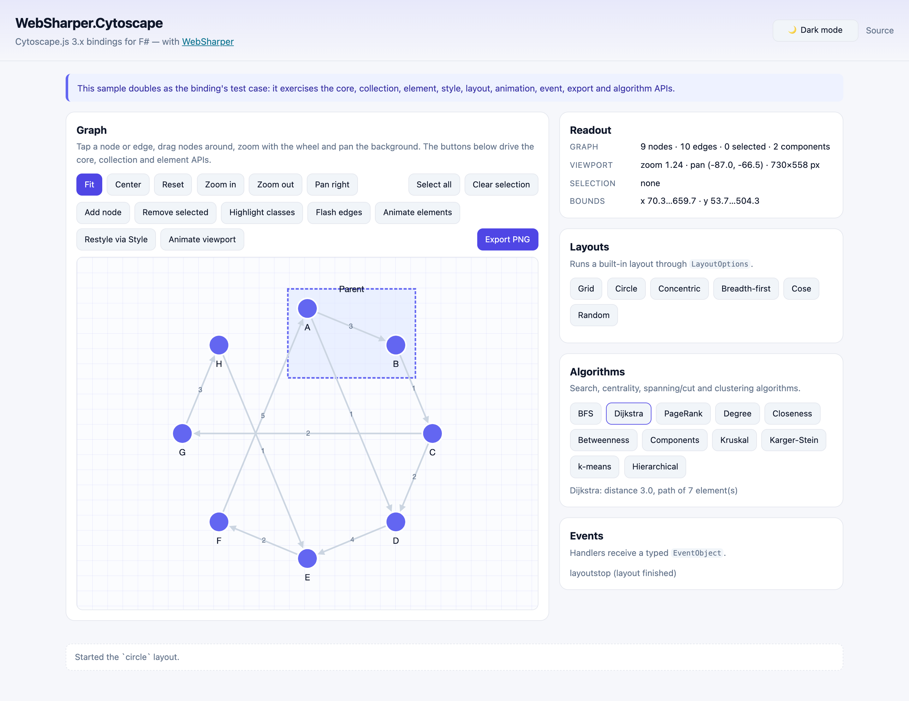

# WebSharper.Cytoscape

[](https://www.nuget.org/packages/WebSharper.Cytoscape)

WebSharper bindings for [Cytoscape.js](https://js.cytoscape.org/) 3.x (3.35.0+)
— the graph theory and network visualisation library — for F# and C# web apps.

The binding consumes the npm package [`cytoscape`](https://www.npmjs.com/package/cytoscape)
as an ES module (`import cytoscape from "cytoscape"`) and is bundled by your
toolchain (esbuild in the sample); there is no CDN `<script>` tag.

This repository contains:

| Project | Purpose |
| --- | --- |
| `WebSharper.Cytoscape` | The binding: WIG definitions for `Cytoscape` (the core), `Eles`/`Ele`, `Nodes`/`Node`, `Edges`/`Edge`, `Layout`, `Style`, `Animation`, `EventObject`, the option/config objects and the algorithm result types. |
| `WebSharper.Cytoscape.Sample` | A WebSharper SPA (esbuild → `dist/`) that drives the whole surface: the core and collection APIs, selection, classes and styles, the built-in layouts, element and viewport animations, typed events, PNG export, and the search, centrality, spanning/cut and clustering algorithms. |

## Live demos

**Try it live:** [Open the sample in your browser](https://dotnet-websharper.github.io/cytoscape/)



The sample doubles as the binding's [test case](#running-the-test-case): it
creates a compound-node graph, runs every built-in layout, and exercises the
core, collection, element, style, layout, animation, event, export and algorithm
APIs. It is light-themed by default and has a light/dark theme switcher
(persisted in `localStorage`).

- **Sample (this repository):** <https://dotnet-websharper.github.io/cytoscape/>
- **Source repository:** <https://github.com/dotnet-websharper/cytoscape>
- **Cytoscape.js documentation:** <https://js.cytoscape.org/>
- **WebSharper bindings:** <https://websharper.com/bindings>

## Install

```bash
dotnet add package WebSharper.Cytoscape
```

Or with Paket:

```fsharp
nuget WebSharper.Cytoscape
```

The package targets `netstandard2.0` and works with any WebSharper 10 or 11
project. It supports Cytoscape.js `>= 3.35.0 < 4.0.0` (the 3.x line); the
library itself is pulled from npm (`cytoscape`), so the JS bundle step must
resolve it (WebSharper's SPA/esbuild build does this automatically).

## Usage

All types live in the `WebSharper.Cytoscape` namespace. The JavaScript names are
capitalised for .NET (`cy.add(...)` is `cy.Add(...)`, `eles.boundingBox()` is
`eles.BoundingBox()`); option objects are `Pattern.Config` types with named
fields.

### Create a graph

```fsharp
open WebSharper
open WebSharper.Cytoscape
open WebSharper.JavaScript

let cy =
    Cytoscape(
        CytoscapeOptions(
            Container = container, // a Dom.Element
            Elements =
                [|
                    ElementObject(Data = ElementData(Id = "a"))
                    ElementObject(Data = ElementData(Id = "b"))
                    ElementObject(Data = ElementData(Id = "c"))
                    ElementObject(Data = ElementData(Id = "ab", Source = "a", Target = "b"))
                    ElementObject(Data = ElementData(Id = "bc", Source = "b", Target = "c"))
                |],
            Style =
                [|
                    StyleConfig(
                        selector = "node",
                        style =
                            New [
                                "background-color", box "#6366f1"
                                "label", box "data(id)"
                            ]
                    )
                    StyleConfig(
                        selector = "edge",
                        style =
                            New [
                                "width", box 2
                                "line-color", box "#cbd5e1"
                                "target-arrow-shape", box "triangle"
                                "curve-style", box "bezier"
                            ]
                    )
                |],
            Layout = LayoutOptions(Name = "cose", Fit = true, Padding = 40.)
        )
    )
```

`StyleConfig`'s `selector`/`style` fields are required, so they are passed to the
constructor with their lowercase names; `CytoscapeOptions`, `LayoutOptions`,
`ElementObject`, `ElementData` and the other option objects have only optional
fields and use the object-initialiser syntax.

### Collections and elements

```fsharp
cy.Nodes()                    // Nodes
cy.Edges()                    // Edges
cy.Elements().Filter(":selected")
cy.GetElementById("a")        // Eles (a collection of one)
cy.Nodes().First()            // Ele
```

The class hierarchy mirrors the JavaScript API: `Eles` (collection) ← `Ele`
(singular) ← `Node`/`Edge` ← `Nodes`/`Edges`. Collection-returning methods are
typed `Eles`/`Nodes`/`Edges`, so chaining stays typed.

### Events

Handlers receive a typed `EventObject` (`Type`, `Target`, `Position`,
`RenderedPosition`, `OriginalEvent`, plus `PreventDefault`/`StopPropagation`):

```fsharp
cy.Elements().On("select", fun (e: EventObject) ->
    Console.Log(sprintf "%s selected" (As<Ele> e.Target).Id()))
```

### Layouts

```fsharp
cy.Layout(
    LayoutOptions(
        Name = "concentric",
        Animate = true,
        AnimationDuration = 500,
        Fit = true,
        Padding = 40.,
        Equidistant = true,
        Concentric = System.Func<WebSharper.Cytoscape.Node, float>(fun n -> float (n.Degree()))
    )
)
    .Run()
|> ignore
```

`LayoutOptions` is a single option bag covering the shared fields and the
specific options of the `null`, `random`, `preset`, `grid`, `circle`,
`concentric`, `breadthfirst` and `cose` layouts; which fields apply is selected
by `Name`. Function-typed optional fields are `System.Func`/`System.Action`
values (WIG property functions), so wrap F# lambdas as shown above. `Run()` (or
`Start()`) starts the layout; `Cy.MakeLayout` creates one without running it.

### Algorithms

The algorithm result types carry the documented read-only members:

```fsharp
let dijkstra = cy.Elements().Dijkstra(AlgorithmOptions(Root = node))
let distance = dijkstra.DistanceTo(target)
let path = dijkstra.PathTo(target)

let rank = cy.Elements().PageRank(AlgorithmOptions()).Rank(node)
let components = cy.Elements().Components().Length

let clusters =
    cy.Nodes().KMeans(
        ClusteringOptions(
            Attributes = [| System.Func<WebSharper.Cytoscape.Node, float>(fun n -> float (n.Degree())) |],
            K = 2
        )
    )
```

| Algorithm | Returned type |
| --- | --- |
| `BreadthFirstSearch` / `DepthFirstSearch` | `BFS` / `DFS` (`Path`, `Found`) |
| `Dijkstra` | `Dijkstra` (`DistanceTo`, `PathTo`) |
| `AStar` | `AStar` (`Found`, `Distance`, `Path`) |
| `FloydWarshall` | `FW` (`Distance`, `Path`) |
| `BellmanFord` | `BF` (`DistanceTo`, `PathTo`, `HasNegativeWeightCycle`, `NegativeWeightCycles`) |
| `Hierholzer` | `Hierholzer` (`Found`, `Trail`) |
| `Kruskal` | `Eles` |
| `KargerStein` | `KargerStein` (`Cut`, `Components`, `Partition1`, `Partition2`) |
| `HopcroftTarjanBiconnected` / `Htb` | `HopcroftTarjanBiconnected` (`Cut`, `Components`) |
| `TarjanStronglyConnected` / `Tsc` | `TarjanStronglyConnected` (`Cut`, `Components`) |
| `PageRank` | `PageRank` (`Rank`) |
| `DegreeCentrality` | `DegreeCentrality` (`Degree`, `Indegree`, `Outdegree`) |
| `DegreeCentralityNormalized` | `DegreeCentralityN` (`Degree`, `Indegree`, `Outdegree`) |
| `ClosenessCentrality` | `float` |
| `ClosenessCentralityNormalized` | `ClosenessCentralityN` (`Closeness`) |
| `BetweennessCentrality` | `BetweennessCentrality` (`Betweenness`, `BetweennessNormalized`, `BetweennessNormalised`) |
| `MarkovClustering`, `KMeans`, `KMedoids`, `AffinityPropagation` | `Nodes[]` |
| `HierarchicalClustering` | `Nodes[]` |
| `FuzzyCMeans` | `FuzzyCMeansResult` (`Clusters`, `DegreeOfMembership`) |

See the original [documentation](https://js.cytoscape.org/#collection/algorithms)
for the semantics of each algorithm.

### Animations, styles and export

```fsharp
cy.Elements().Animate(
    AnimateOptions(
        Style = New [ ("opacity", box 0.45) ],
        Duration = 600,
        Easing = "ease-in-out",
        Complete = System.Action(fun () -> ())
    )
)
|> ignore

cy.Style().Selector("node").Style("background-color", "#f59e0b").Update() |> ignore

let dataUrl = cy.Png()
```

`Png`/`Jpg`/`Jpeg` return a data URI when called without options; with
`ImageOptions` the output depends on `Output` (`base64uri`, `base64`, `blob`,
`blob-promise`), so the binding types the options overload's result as the union
of `string`, `Blob` and `Promise<Blob>` (cast with `As<_>`).

## Notes on the API

- **The package is npm-based.** The binding imports `cytoscape` from its npm
  package and registers it as an `NpmDependencies` entry; add `cytoscape` to your
  front-end dependencies (the sample's esbuild config bundles it). Nothing is
  fetched from a CDN.
- **Type mapping.** The original documentation talks about `cy`, `eles`, `ele`,
  `nodes`, `node`, `edges`, `edge` and `layout`; the binding names them
  `Cytoscape`, `Eles`, `Ele`, `Nodes`, `Node`, `Edges`, `Edge` and `Layout`.
  Option objects are named `...Options`/`...Config` and their fields are the
  JavaScript property names (capitalised for .NET).
- **The container must be in the DOM** before the graph is created. Create the
  graph after your template has been bound (as the sample does), not before.
- **Custom data fields.** `ElementData` types the well-known fields (`Id`,
  `Parent`, `Source`, `Target`, `Weight`, `Name`, …). Further JSON-serializable
  fields can be set dynamically, because the option objects compile to plain
  JavaScript objects:

  ```fsharp
  let data = ElementData(Id = "a")
  data?custom <- "myField"
  ```

- **Function-typed methods accept F# lambdas.** Event handlers, `ForEach`,
  `Sort`, `Kruskal` etc. take F# functions (`fun e -> …`); function-typed
  *option fields* (`LayoutOptions.Concentric`, `ClusteringOptions.Attributes`,
  `AnimateOptions.Complete`, …) are `System.Func`/`System.Action` values, as in
  the examples above.
- **`Map`/`Reduce` are generic in JavaScript.** Their mapped value type is
  `obj` (`Map` returns `obj[]`); cast the values with `As<'T>` when reading them.
- **Read-only algorithm results** are returned as `Class` types with the
  documented members; some are properties (e.g. `BFS.Found`) and some are
  methods (e.g. `Dijkstra.PathTo`). The runtime names are used where the
  published declarations differ (e.g. `KargerStein.Partition1`/`Partition2`,
  and `HierarchicalClustering` returns a `Nodes[]`).
- **Compound (parent) nodes** are supported through `ElementData.Parent` and the
  `Nodes` compound API (`Parent`, `Ancestors`, `Children`, `Descendants`,
  `Siblings`, …).

## Running the test case

The sample is a static SPA. Building it runs `npm install` and esbuild and emits
`dist/` at the repository root:

```bash
dotnet build WebSharper.Cytoscape.Sample/WebSharper.Cytoscape.Sample.fsproj -c Release
dotnet serve -d dist -p 8080
```

`dotnet serve` comes from the [`dotnet-serve`](https://github.com/dotnet-serve/dotnet-serve)
tool; install it once with `dotnet tool install -g dotnet-serve` (or use
`dotnet tool run dotnet-serve` with a local tool manifest).

Open <http://localhost:8080/>. Cytoscape.js is fully bundled, so no network
access is needed. The buttons drive the whole binding — use them to verify a
change end to end: the toolbar, every layout, every algorithm and the theme
switcher.

## Building from source

### Prerequisites

- [.NET SDK 11](https://dotnet.microsoft.com/download) (the WebSharper 11
  compiler needs it; the `websharper100` branch builds on .NET 10).
- [Node.js](https://nodejs.org/) (for the sample's esbuild step).
- [Paket](https://fsprojects.github.io/Paket/) as a local dotnet tool (configured
  in `.config/dotnet-tools.json`).

### Restore and build

```bash
dotnet tool restore
dotnet paket restore
dotnet build WebSharper.Cytoscape.sln -c Release
```

The binding targets `netstandard2.0`; the sample is a static bundle.

### Pack the NuGet package

```bash
./build WS-Package
```

`WS-Package` builds, packs (via `nuget/WebSharper.Cytoscape.paket.template`) and
places the nupkg in the default output folder (`WSPackageFolder=…` overrides it).
The template ships the `netstandard2.0` assembly, its XML docs and — on the
WebSharper 11 line — the `.websharper` sidecar.

## Deployment

Pushing to the default branch triggers `.github/workflows/ghpages.yml`, which
builds the sample in Release and publishes `dist/` to the `gh-pages` branch via
GitHub Pages.

## Repository layout

```
WebSharper.Cytoscape/            # the binding (WIG definitions)
  Main.fs
WebSharper.Cytoscape.Sample/     # static SPA demo / test case
  Client.fs
  index.html
  site.css
  esbuild.config.mjs
  wsconfig.json
docs/
  sample.png                     # screenshot of the running sample
nuget/                           # Paket pack template
.github/workflows/ghpages.yml    # build + deploy the sample
```

## License

Apache 2.0 — see [LICENSE.md](LICENSE.md).